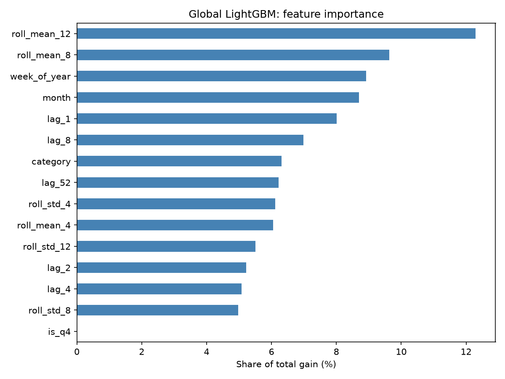
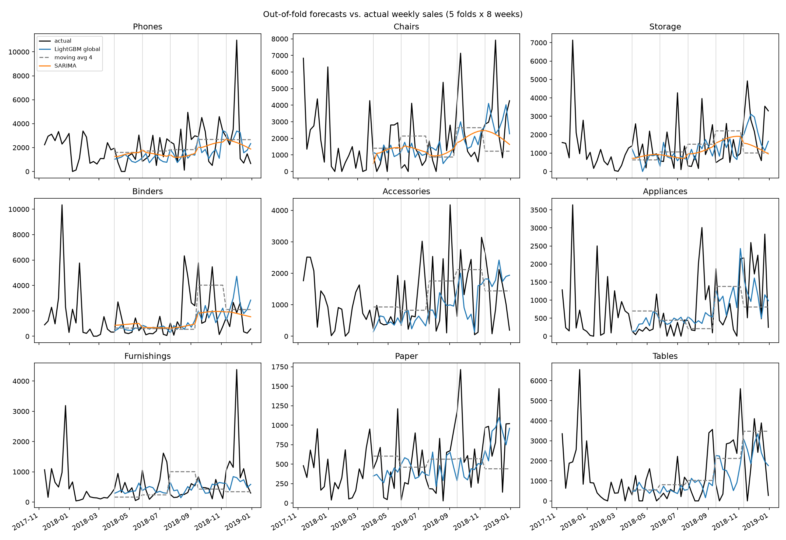

# Multi-Category Sales Forecasting

## Problem
Forecast weekly sales for each product sub-category of a multi-category retail store, and build the solution as a reproducible ML pipeline.

## Dataset
Superstore Sales Dataset (Kaggle, by rohitsahoo): 9,800 order lines, January 2015 to December 2018. Only `Sales` is numeric (no discount, quantity, or profit). The data is not included in this repo: download `train.csv` from Kaggle and save it as `data/superstore.csv`.

## Data preparation
- Converted `Order Date` to a real date (day/month/year format).
- Removed 1 duplicated row (identical in every column except `Row ID`).
- Aggregated sales to weekly totals per sub-category, filling empty weeks with 0.
- Modeling 9 sub-categories with few zero-sales weeks: Phones, Chairs, Storage, Binders, Accessories, Appliances, Furnishings, Paper, Tables.
- Left out Copiers and Machines (large sales but mostly zero weeks) and small sub-categories such as Fasteners, Labels, Envelopes, and Supplies.

## Key findings from EDA
- Sales peak in September, November, and December.
- There is a repeating yearly cycle.
- There is an upward trend over the four years.

## Project status
Days 1-6 done: data preparation and EDA, walk-forward validation, baselines, feature engineering, LightGBM (global and per-category), SARIMA, error analysis, MLflow tracking, Optuna tuning, a final saved model, a FastAPI service, pytest tests, a Docker image, and a Streamlit dashboard. Day 7 (final README polish and demo) is next.

## Validation and baselines

**Validation:** walk-forward with an expanding window. 5 folds, each forecasting the next 8 weeks. The last 40 weeks of the 209-week series are used for testing, and the first training window is 169 weeks. The final fold covers the Q4 peak.

**Metrics:** MAE, RMSE, sMAPE and MASE, implemented in `src/metrics.py`.

**Baselines** (in `src/baselines.py`): naive (last week), seasonal naive (same week last year) and a 4-week moving average.

**Baseline results** (average over 5 folds and 9 sub-categories):

| Model | MAE | RMSE | sMAPE | MASE |
|---|---|---|---|---|
| 4-week moving average | 987 | 1206 | 82.9 | 1.23 |
| Seasonal naive | 1127 | 1460 | 98.5 | 1.38 |
| Naive | 1133 | 1385 | 91.1 | 1.45 |

The 4-week moving average is the best baseline, so it is the bar every later model must beat. Seasonal naive is no better than naive because the series are short and noisy.

## Features and LightGBM

### Features (`src/features.py`)
The wide weekly table is reshaped to long format (one row per week per sub-category), then:

| Group | Features |
|---|---|
| Lags | `lag_1`, `lag_2`, `lag_4`, `lag_8`, `lag_52` (computed per category) |
| Rolling | mean and std over 4, 8, 12 weeks, shifted by 1 week so the current week never leaks in |
| Calendar | `week_of_year`, `month`, `is_q4` |
| Category | sub-category as a categorical feature (global model only) |

The dataset has no Discount column, so discount features from the original plan were skipped.

### Recursive forecasting
Each fold forecasts 8 weeks from the cutoff. The model predicts one week, writes that prediction back as if it were real sales, rebuilds the features, and predicts the next week. Real future values are never used, so the comparison with the baselines is fair.

### Results (same 5 walk-forward folds as the baselines)

| Model | MAE | RMSE | sMAPE | MASE |
|---|---|---|---|---|
| **lgbm_global** | **867** | **1133** | **75.9** | **1.07** |
| lgbm_per_category | 986 | 1260 | 89.5 | 1.23 |
| moving_avg_4 | 987 | 1206 | 82.9 | 1.23 |
| seasonal_naive | 1127 | 1460 | 98.5 | 1.38 |
| naive | 1133 | 1385 | 91.1 | 1.45 |

- **One global model beats nine separate models.** Each series has only 169–201 training weeks, which is too little for a per-category model. The global model learns shared patterns (such as seasonality) from all nine series at once.
- The global model has about 12% lower MAE than the best baseline and wins in 6 of 9 sub-categories. Its biggest win is Chairs (1,204 vs 1,602).
- **Where it does not win:** Phones and Binders (near ties with the moving average and naive) and Tables (the moving average is better).
- MASE is still slightly above 1, which shows how noisy weekly sub-category sales are.

### Feature importance


The 8- and 12-week rolling means and the calendar features carry the most weight. `is_q4` gets no weight because `month` already contains the same information.

## Statistical models and error analysis

### SARIMA (`src/stat_models.py`)
ARIMA(1,1,1) with Fourier terms (2 sin/cos pairs, period 52.18 weeks) as external regressors for the yearly cycle. A full seasonal SARIMA with period 52 is too slow and unstable with only 4 years of weekly data. It was fitted on the 4 largest, least sparse series: Phones, Chairs, Storage and Binders. Tables was replaced by Binders because it has 61 zero weeks.

### Results on the same 4 sub-categories (same 5 walk-forward folds)

| Model | MAE | RMSE | sMAPE | MASE |
|---|---|---|---|---|
| **lgbm_global** | **1163** | 1554 | **75.2** | **0.98** |
| sarima | 1171 | **1531** | 75.4 | **0.98** |
| lgbm_per_category | 1332 | 1742 | 86.0 | 1.11 |
| moving_avg_4 | 1341 | 1644 | 81.9 | 1.12 |
| naive | 1411 | 1785 | 81.6 | 1.15 |
| seasonal_naive | 1530 | 2009 | 95.9 | 1.28 |

SARIMA and the global LightGBM are tied, and both beat every baseline by about 13% on MAE.

### Forecast vs. actual


### Where the models fail
- **Spikes:** 11% of test weeks are spikes (more than 2 std above the category average), but they cause 31% of all error. All 10 worst weeks are spikes. Single large orders cannot be predicted from past sales, and every model misses them.
- **Q4:** error from September to December is about 1.5x the rest of the year.
- **Sparse series:** Tables (61 zero weeks) has the worst sMAPE (97.7%), because a forecast against a zero week counts as 200% sMAPE.

### Best model
**Global LightGBM** is the best overall: MAE 867 vs 987 for the best baseline across all 9 sub-categories, and it wins in 6 of 9. It does **not** beat the best baseline on Tables (-3%), Binders (-2%, where SARIMA is best) or Phones (-1%). These are near ties. MASE is still above 1 for 8 of 9 categories, so weekly sub-category sales remain hard to forecast from past sales alone.

## Experiment tracking and tuning (Day 5)

- Every model (3 baselines, LightGBM global and per-category, SARIMA) is logged to **MLflow** with its parameters, metrics (overall and per sub-category), a per-category MAE plot, and the full per-fold results.
- LightGBM was tuned with **Optuna** (40 trials, TPE sampler). To avoid tuning on the test weeks, Optuna only saw the weeks *before* the 5 test folds (3 folds x 8 weeks).
- Tuning improved validation MASE from 1.028 to 0.960, but on the untouched test folds the gain was negligible:

| Model | MAE | RMSE | sMAPE | MASE |
|---|---|---|---|---|
| LightGBM global (tuned) | 863 | 1133 | 76.3 | 1.06 |
| LightGBM global (default) | 867 | 1133 | 75.9 | 1.07 |
| Moving average (4 weeks) | 987 | 1206 | 82.9 | 1.23 |

- Conclusion: the model is limited by its features, not its hyperparameters. The tuned settings are used for the final model.
- Limitation: tree models can't extrapolate trends. Phones is where LightGBM is weakest (both the default and tuned versions lose to the 4-week moving average), and its 2019 forecast looks low compared with 2018's growth.

## Final model

- `python -m src.train` trains the global LightGBM on all 209 weeks and saves `models/lgbm_global.joblib` (model, features, categories, params and sales history).
- `python -m src.predict Phones 8` forecasts one sub-category for 1 to 26 weeks ahead, week by week.

To view the runs locally: `mlflow ui --backend-store-uri sqlite:///mlflow.db`

## API (Day 6)

`src/api.py` is a FastAPI app that loads the saved model once and serves forecasts.

| Endpoint | What it does |
|---|---|
| `GET /health` | Returns `{"status": "ok"}` |
| `GET /categories` | Lists the 9 sub-categories the model can forecast |
| `GET /forecast?sub_category=Phones&horizon=8` | Weekly forecast for 1 to 26 weeks ahead |

Example response:

```json
{
  "sub_category": "Phones",
  "horizon": 2,
  "forecast": [
    {"week": "2019-01-06", "forecast": 450.3},
    {"week": "2019-01-13", "forecast": 496.15}
  ]
}
```

An unknown sub-category returns `400`, and a horizon outside 1–26 returns `422`.

Run locally: `uvicorn src.api:app --reload`, then open http://127.0.0.1:8000/docs

## Tests

`pytest -v` runs 27 tests:
- **Data** (`tests/test_data.py`): the weekly table has 209 consecutive weeks with no gaps, duplicates, missing values or negative sales.
- **Leakage** (`tests/test_features.py`): every lag equals sales exactly k weeks earlier, rolling features use only previous weeks, and replacing all future sales with 999,999 leaves every earlier feature unchanged.
- **API** (`tests/test_api.py`): the forecast has exactly `horizon` consecutive weeks starting 2019-01-06, and bad inputs return the right error codes.

## Docker

The image contains only the API code, the saved model, and the libraries in `requirements-api.txt`.

```bash
docker build -t sales-forecast .
docker run --rm -p 8000:8000 sales-forecast
```

Then open http://localhost:8000/docs

## Dashboard

`streamlit run dashboard.py` opens a page where you pick a sub-category and horizon and see the last two years of sales with the forecast.